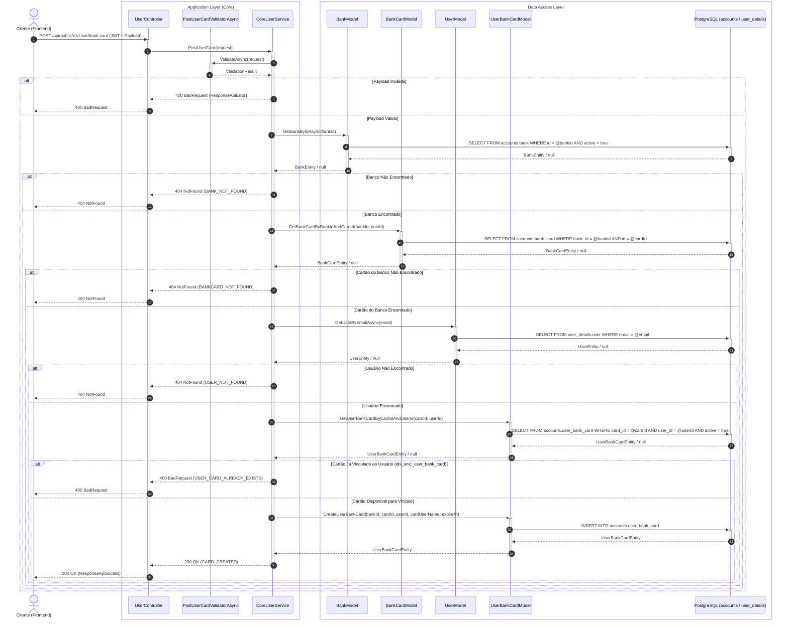
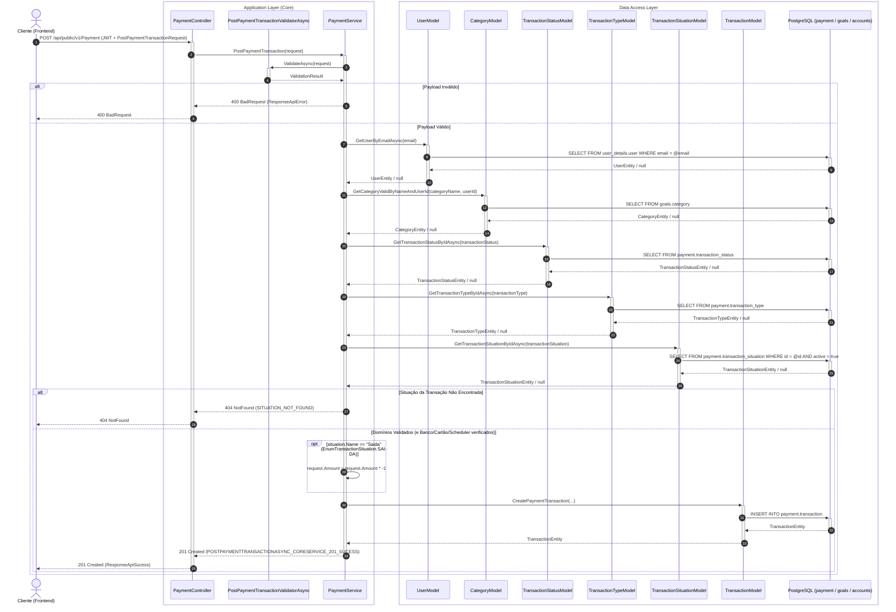
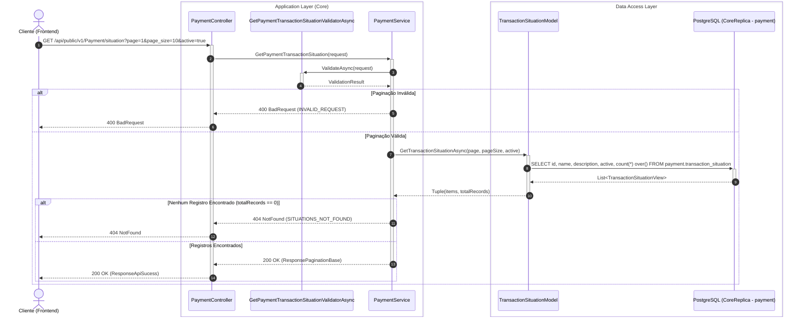

# Endpoints de Usuário, Bancos, Cartões, Metas, Categorias e Pagamentos (Core Service)

O Monólito `NievoEasyFin.Core` (Porta interna `8082`, rota de entrada Kong `/api/core`) gerencia as entidades do domínio financeiro, incluindo instituições bancárias, contas do usuário, cartões de crédito/débito, planejamento de metas, hierarquia de categorias orçamentárias e transações de pagamento (`payment`).

Seguindo os princípios **SOLID** (em especial o Princípio da Responsabilidade Única - *SRP* e o Princípio da Segregação de Interfaces - *ISP*) e as convenções de design de **APIs RESTful**, os serviços e controllers foram desacoplados em contratos granulares:
- **`UserController`** (`/api/public/v1/User`): Consome `IUserService` para gerenciar recursos vinculados diretamente ao usuário logado (contas bancárias, cartões, metas e categorias).
- **`PaymentController`** (`/api/public/v1/Payment`): Consome `IPaymentService` para gerenciar lançamentos financeiros (`payment.transaction`), status (`payment.transaction_status`), tipos (`payment.transaction_type`), agendadores (`payment.scheduler_type`) e situações de fluxo de caixa (`payment.transaction_situation` — `Entrada` / `Saida`).
- **`BankController` (Público)** (`/api/public/v1/Bank`): Consome `IPublicBankService` para consulta do catálogo de instituições financeiras e produtos bancários.
- **`CardController`** (`/api/public/v1/Card`): Consome `ICardService` para consulta de tipos e bandeiras de cartões.
- **`BankController` (Privado)** (`/api/private/v1/Bank`): Consome `IPrivateBankService` para operações administrativas de cadastro de bancos e cartões no catálogo global.
- **`HealthCheckController`** (`/api/admin/v1/HealthCheck`): Verificações de integridade de nós de banco de dados e serviço.

---

## 👤 1. Endpoints do Usuário (`/api/public/v1/User`)

Estes endpoints exigem o cabeçalho `Authorization: Bearer <token_jwt>` contendo a claim de e-mail do usuário autenticado.

### 1. `POST /api/public/v1/User/banks`
Vincula uma conta bancária ao usuário logado (`accounts.user_bank`).

- **Headers:** `Authorization: Bearer <token_jwt>`
- **Corpo da Requisição (Request Body):**
  ```json
  {
    "bank_name": "Itaú Unibanco",
    "bank_type": 1,
    "nick_name": "Minha Conta Principal"
  }
  ```
- **Respostas:**
  - `200 OK`: Vínculo criado com sucesso (`accounts.user_bank`).
  - `400 Bad Request`: Vínculo já cadastrado para este usuário.
  - `404 Not Found`: Usuário ou Banco não encontrado.

---

### 2. `GET /api/public/v1/User/banks`
Retorna a lista paginada de contas bancárias vinculadas ao usuário logado.

- **Headers:** `Authorization: Bearer <token_jwt>`
- **Parâmetros de Consulta (Query Params):**
  - `page`: Número da página (padrão: 1).
  - `page_size`: Quantidade de itens por página (padrão: 10).
- **Respostas:**
  - `200 OK`: Retorna `ResponsePaginationBase<GetUserBanksResponse>`.

---

### 3. `POST /api/public/v1/User/bank-card`
Cadastra e vincula um cartão de banco à carteira do usuário logado (`accounts.user_bank_card`).

- **Headers:** `Authorization: Bearer <token_jwt>`
- **Corpo da Requisição:**
  ```json
  {
    "bank_id": 2,
    "card_id": 5,
    "nickname": "Cartão Black Itaú",
    "expire_at": "2029-12-31T23:59:59Z"
  }
  ```
- **Regras de Validação e Unicidade (`idx_unic_user_bank_card`):**
  - `bank_id` e `card_id`: Obrigatórios e maiores que zero (`> 0`).
  - `nickname` (`CardUserName`): Obrigatório.
  - `expire_at`: Data futura (`expire_at > DateTime.Today`).
  - **Unicidade (`card_id` + `user_id`):** Verifica previamente via `GetUserBankCardByCardIdAndUserId` se o usuário já possui o cartão ativo vinculado na carteira, prevenindo violação do índice único `idx_unic_user_bank_card`.
- **Respostas:**
  - `200 OK`: Cartão do usuário cadastrado (`POSTUSERCARDASYNC_CORESERVICE_200_CARD_CREATED`).
  - `400 Bad Request`: Dados inválidos ou cartão já existente para este usuário (`POSTUSERCARDASYNC_CORESERVICE_400_USER_CARD_ALREADY_EXISTS`).
  - `404 Not Found`: Banco, Cartão do Banco ou Usuário não encontrado (`POSTUSERCARDASYNC_CORESERVICE_404_BANK_NOT_FOUND`, `POSTUSERCARDASYNC_CORESERVICE_404_BANKCARD_NOT_FOUND`, `POSTUSERCARDASYNC_CORESERVICE_404_USER_NOT_FOUND`).



---

### 4. `GET /api/public/v1/User/bank-card`
Retorna os cartões bancários cadastrados na carteira do usuário logado.

- **Headers:** `Authorization: Bearer <token_jwt>`
- **Parâmetros de Consulta:**
  - `page`: Número da página.
  - `page_size`: Quantidade de itens por página.
  - `bank_id`: Filtro por instituição financeira (opcional).
  - `active`: Filtro por estado ativo/inativo (opcional).
  - `flag`: Filtro por bandeira do cartão (opcional).
- **Respostas:**
  - `200 OK`: Retorna `ResponsePaginationBase<GetUserBankCardResponse>`.

---

### 5. `POST /api/public/v1/User/goal`
Cria uma nova meta financeira ou teto orçamentário para o usuário logado (`goals.goals`).

- **Headers:** `Authorization: Bearer <token_jwt>`
- **Corpo da Requisição:**
  ```json
  {
    "name": "Reserva de Emergência",
    "description": "Acumular 6 meses de despesas essenciais",
    "amount": 25000,
    "is_percent": false,
    "expire_at": "2027-12-31T00:00:00Z"
  }
  ```
- **Regras de Validação:**
  - `name`: Obrigatório, com tamanho entre 2 e 99 caracteres.
  - `amount`: Valor monetário ou percentual maior que zero (`amount > 0`).
  - `expire_at`: Obrigatório e data no futuro (`expire_at > DateTime.Today`).
  - **Unicidade:** Não é permitido duplicar o nome de uma meta ativa para o mesmo usuário.
- **Respostas:**
  - `200 OK`: Meta criada com sucesso (`POSTUSERGOALASYNC_CORESERVICE_200_GOAL_CREATED`).
  - `400 Bad Request`: Parâmetros inválidos, data expirada ou meta já existente (`POSTUSERGOALASYNC_CORESERVICE_400_GOAL_ALREADY_EXIST`).
  - `404 Not Found`: Usuário não encontrado.

---

### 6. `GET /api/public/v1/User/goal`
Retorna a lista paginada de metas financeiras do usuário logado.

- **Headers:** `Authorization: Bearer <token_jwt>`
- **Parâmetros de Consulta:**
  - `active` (`boolean`, opcional, padrão: `true`): Filtra por metas ativas ou inativas.
  - `page` (`int`, opcional, padrão: `1`): Número da página.
  - `page_size` (`int`, opcional, padrão: `10`): Quantidade de itens por página.
- **Respostas:**
  - `200 OK`: Retorna `ResponsePaginationBase<UserGoalView>` contendo itens com `id`, `name`, `description`, `active`, `amount`, `is_percent`, `expire_at`, `created_at`, `updated_at`.
  - `400 Bad Request`: Paginação inválida.
  - `404 Not Found`: Usuário não encontrado.

---

### 7. `POST /api/public/v1/User/category`
Cria uma categoria financeira associada à conta do usuário (`goals.category`).

- **Headers:** `Authorization: Bearer <token_jwt>`
- **Corpo da Requisição:**
  ```json
  {
    "name": "Supermercado",
    "description": "Compras de alimentos e mantimentos",
    "goal": 1,
    "parent_category": null
  }
  ```
- **Regras de Negócio e Validação:**
  - `name`: Obrigatório, tamanho entre 2 e 99 caracteres.
  - **Exclusividade Mútua Obrigatória:** A categoria **deve** ser associada estritamente a uma Meta (`goal > 0`) **OU** a uma Categoria Pai (`parent_category > 0`), nunca a ambos e nunca a nenhum (`POSTUSERCATEGORYASYNC_CORESERVICE_400_CATEGORY_ONLY_CAN_BE_CREATED_WITH_ONE_GOAL_OR_PARENT`).
  - Se informada `parent_category`, ela deve existir e estar ativa no banco (`POSTUSERCATEGORYASYNC_CORESERVICE_404_PARENTCATEGORY_NOT_FOUND`).
  - **Unicidade:** Não é permitido duplicar o nome de uma categoria ativa para o mesmo usuário (`POSTUSERCATEGORYASYNC_CORESERVICE_400_CATEGORY_ALREADY_EXIST`).
- **Respostas:**
  - `200 OK`: Categoria criada com sucesso (`POSTUSERCATEGORYASYNC_CORESERVICE_200_CREATED`).
  - `400 Bad Request`: Violação de vínculo exclusivo, nome duplicado ou campos inválidos.
  - `404 Not Found`: Usuário ou Categoria Pai não encontrada.

---

### 8. `GET /api/public/v1/User/category`
Retorna a lista paginada de categorias do usuário logado, incluindo o nome e descrição da meta vinculada via `LEFT JOIN`.

- **Headers:** `Authorization: Bearer <token_jwt>`
- **Parâmetros de Consulta:**
  - `active` (`boolean`, opcional, padrão: `true`): Filtra por categorias ativas ou inativas.
  - `page` (`int`, opcional, padrão: `1`): Número da página.
  - `page_size` (`int`, opcional, padrão: `10`): Quantidade de itens por página.
- **Respostas:**
  - `200 OK`: Retorna `ResponsePaginationBase<UserCategoryView>` contendo itens com `id`, `name`, `description`, `active`, `parent_category`, `goal_name`, `goal_description`, `created_at`, `updated_at`.
  - `400 Bad Request`: Paginação inválida.
  - `404 Not Found`: Usuário não encontrado.

---

## 🏦 2. Endpoints Públicos de Bancos (`/api/public/v1/Bank`)

Controlador dedicado a consultas do catálogo público de instituições financeiras e seus cartões disponíveis.

### 9. `GET /api/public/v1/Bank`
Retorna uma lista paginada de instituições financeiras cadastradas no sistema (`accounts.bank`).

- **Headers:** `Authorization: Bearer <token_jwt>`
- **Parâmetros de Consulta:**
  - `page`: Número da página (padrão: 1).
  - `page_size`: Quantidade de itens por página (padrão: 10).
- **Respostas:**
  - `200 OK`: Retorna `ResponsePaginationBase<GetBanksResponse>`.

---

### 10. `GET /api/public/v1/Bank/card`
Consulta o catálogo de cartões de banco filtrado por parâmetros.

- **Headers:** `Authorization: Bearer <token_jwt>`
- **Parâmetros de Consulta:**
  - `page`: Número da página.
  - `page_size`: Quantidade de itens por página.
  - `bank_id`: Identificador do banco.
  - `card_type`: Tipo de cartão.
  - `flag`: Bandeira do cartão.
- **Respostas:**
  - `200 OK`: Retorna `ResponsePaginationBase<BankCardView>`.

---

## 💳 3. Endpoints Públicos de Cartões (`/api/public/v1/Card`)

Controlador responsável pela consulta de metadados de cartões (tipos e bandeiras).

### 11. `GET /api/public/v1/Card/type`
Retorna os tipos de cartão cadastrados no sistema (`Crédito`, `Débito`, `Múltiplo`).

- **Headers:** `Authorization: Bearer <token_jwt>`
- **Parâmetros de Consulta:** `page`, `page_size`.
- **Respostas:**
  - `200 OK`: Retorna `ResponsePaginationBase<GetCardTypeResponse>`.

---

### 12. `GET /api/public/v1/Card/flag`
Retorna as bandeiras de cartão cadastradas (`Visa`, `Mastercard`, `Elo`, `Amex`).

- **Headers:** `Authorization: Bearer <token_jwt>`
- **Parâmetros de Consulta:** `page`, `page_size`.
- **Respostas:**
  - `200 OK`: Retorna `ResponsePaginationBase<GetCardFlagResponse>`.

---

## 🔒 4. Endpoints Privados / Administrativos (`/api/private/v1/Bank`)

Controlador reservado a operações administrativas para expansão do catálogo global de bancos e cartões.

### 13. `POST /api/private/v1/Bank`
Cadastra uma nova instituição financeira no catálogo global (`accounts.bank`).

- **Headers:** `Authorization: Bearer <token_jwt>`
- **Corpo da Requisição:**
  ```json
  {
    "name": "Nubank",
    "bank_type": 1
  }
  ```
- **Respostas:**
  - `200 OK`: Banco criado com sucesso (`accounts.bank`).
  - `400 Bad Request`: Banco já existente ou tipo inválido.

---

### 14. `POST /api/private/v1/Bank/card`
Cadastra um novo produto de cartão no catálogo global do sistema (`accounts.bank_card`).

- **Headers:** `Authorization: Bearer <token_jwt>`
- **Corpo da Requisição:**
  ```json
  {
    "bank_id": 2,
    "card_type": 1,
    "name": "Itaú Personnalité Black",
    "flag": "Mastercard"
  }
  ```
- **Respostas:**
  - `200 OK`: Cartão cadastrado no catálogo (`accounts.bank_card`).
  - `404 Not Found`: Banco, Tipo de cartão ou Bandeira não encontrada.

---

## 🛠️ 5. Endpoints de Infraestrutura (`/api/admin/v1/HealthCheck`)

Verifica a saúde do serviço Core e a conectividade com os nós do cluster de banco de dados.

### 15. `GET /api/admin/v1/HealthCheck`
Verifica se o servidor Core está ativo e respondendo.

- **Autorização:** Acesso livre (`[AllowAnonymous]`).
- **Respostas:**
  - `200 OK`: Retorna `{"message": "Alive"}`.

---

### 16. `GET /api/admin/v1/HealthCheck/pgsql:main-node`
Valida conectividade com o nó Master do PostgreSQL (`CoreOrigin`).

- **Headers:** `Authorization: Bearer <token_jwt>`
- **Respostas:**
  - `200 OK`: Retorna resultado da consulta `select 1 as test_mainNode`.
  - `400 Bad Request`: Falha na comunicação com o banco primário.

---

### 17. `GET /api/admin/v1/HealthCheck/pgsql:replica-node`
Valida conectividade com o nó Réplica do PostgreSQL (`CoreReplica`).

- **Headers:** `Authorization: Bearer <token_jwt>`
- **Respostas:**
  - `200 OK`: Retorna resultado da consulta `select 1 as test_replicaNode`.
  - `400 Bad Request`: Falha na comunicação com a réplica de leitura.

---

## 💸 6. Endpoints Públicos de Pagamentos e Transações (`/api/public/v1/Payment`)

Controlador dedicado ao lançamento e consulta de transações financeiras do usuário (`payment.transaction`) e seus domínios auxiliares (`status`, `type`, `scheduler`, `situation`).

### 18. `POST /api/public/v1/Payment`
Registra uma nova transação financeira (`payment.transaction`) vinculada ao usuário autenticado, classificando sua situação (`Entrada` ou `Saida`).

- **Headers:** `Authorization: Bearer <token_jwt>`
- **Corpo da Requisição:**
  ```json
  {
    "name": "Salário Mensal",
    "description": "Crédito folha de pagamento",
    "transaction_status": 2,
    "transaction_type": 2,
    "transaction_situation": 1,
    "categorie": 1,
    "pay_date": "2026-11-12T00:00:00Z",
    "amount": 5500,
    "card": null,
    "bank": 1,
    "scheduler": null
  }
  ```
- **Regras de Validação (`PostPaymentTransactionValidatorAsync`):**
  - `name`, `description` e `category_name`: Obrigatórios (não nulos e não vazios).
  - `amount`: Obrigatório e maior que `0` (`> 0`). Caso a situação da transação seja `Saida` (`EnumTransactionSituation.SAIDA`), o `PaymentService` converte automaticamente o valor para negativo (`request.Amount = request.Amount * -1`) antes de persistir no banco.
  - `transaction_status`: Obrigatório e `> 0`.
  - `transaction_type`: Obrigatório e `> 0`.
  - `transaction_situation`: Obrigatório e `>= 1` (`1 = Entrada`, `2 = Saida`, mapeados em `EnumTransactionSituation`).
  - `bank`: Obrigatório e `>= 0`.
  - `card`: Opcional (`>= 0`, consultado na base apenas quando `> 0`).
  - `scheduler`: Opcional (`>= 0`, consultado na base apenas quando `> 0`).
- **Respostas:**
  - `201 Created`: Transação registrada com sucesso (`POSTPAYMENTTRANSACTIONASYNC_CORESERVICE_201_SUCESS`).
  - `400 Bad Request`: Violação de validação nos campos obrigatórios.
  - `404 Not Found`: Usuário, Categoria, Status, Tipo, Situação (`POSTPAYMENTTRANSACTIONASYNC_CORESERVICE_404_SITUATION_NOT_FOUND`), Banco, Cartão ou Agendador não encontrado.



---

### 19. `GET /api/public/v1/Payment`
Retorna a lista paginada de transações financeiras do usuário autenticado com suporte a múltiplos filtros combinados, incluindo filtro por situação (`transaction_situation_id`).

- **Headers:** `Authorization: Bearer <token_jwt>`
- **Parâmetros de Consulta (Query Params):**
  - `page` (`int`, padrão: `1`): Número da página.
  - `page_size` (`int`, padrão: `10`): Quantidade de itens por página.
  - `transaction_status_id` (`int?`): Filtro por status da transação.
  - `transaction_type_id` (`int?`): Filtro por tipo da transação.
  - `transaction_situation_id` (`int?`): Filtro por situação da transação (`Entrada` / `Saida`).
  - `categorie_id` (`int?`): Filtro por categoria.
  - `pay_date` (`DateTime?`): Filtro por data de pagamento.
  - `card_id` (`int?`): Filtro por cartão do usuário.
  - `bank_id` (`int?`): Filtro por banco do usuário.
  - `scheduler_id` (`int?`): Filtro por recorrência.
  - `created_at` (`DateTime?`): Filtro por data de criação.
- **Respostas:**
  - `200 OK`: Retorna `ResponsePaginationBase<GetPaymentTransactionAsyncResponse>` contendo `id`, `name`, `description`, `status`, `type`, `situation`, `categorie`, `pay_date`, `amount`, `card`, `bank`, `scheduler`, `created_at`.

---

### 20. `GET /api/public/v1/Payment/situation`
Retorna a lista paginada de situações de transação (`Entrada`, `Saida`) cadastradas na tabela `payment.transaction_situation`.

- **Headers:** `Authorization: Bearer <token_jwt>`
- **Parâmetros de Consulta (Query Params):**
  - `page` (`int`, padrão: `1`): Número da página (`> 0`).
  - `page_size` (`int`, padrão: `10`): Quantidade de itens por página (`1..100`).
  - `active` (`bool`, padrão: `true`): Filtra situações ativas ou inativas.
- **Respostas:**
  - `200 OK`: Retorna `ResponsePaginationBase<GetPaymentTransactionSituationAsyncResponse>` (`GETPAYMENTTRANSACTIONSITUATION_CORESERVICE_200_SUCESS`).
  - `400 Bad Request`: Parâmetros de paginação inválidos (`GETPAYMENTTRANSACTIONSITUATION_CORESERVICE_400_INVALID_REQUEST`).
  - `404 Not Found`: Nenhuma situação encontrada (`GETPAYMENTTRANSACTIONSITUATION_CORESERVICE_404_SITUATIONS_NOT_FOUND`).



---

### 21. `GET /api/public/v1/Payment/status`, `/type` e `/scheduler`
Endpoints auxiliares de metadados de transações:
- **`GET /api/public/v1/Payment/status`**: Lista paginada de status (`payment.transaction_status`).
- **`GET /api/public/v1/Payment/type`**: Lista paginada de tipos (`payment.transaction_type`).
- **`GET /api/public/v1/Payment/scheduler`**: Lista paginada de agendadores (`payment.scheduler_type`).
