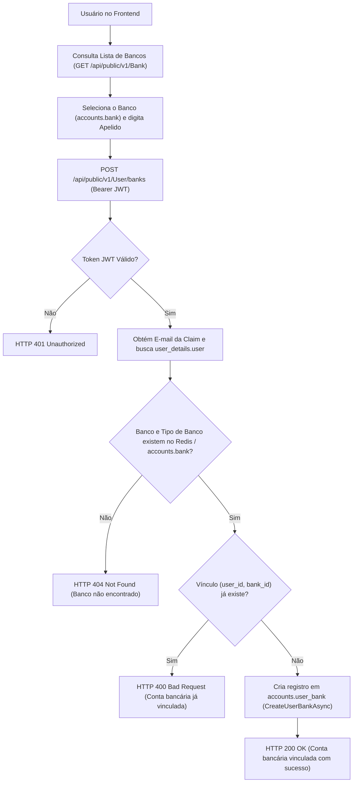
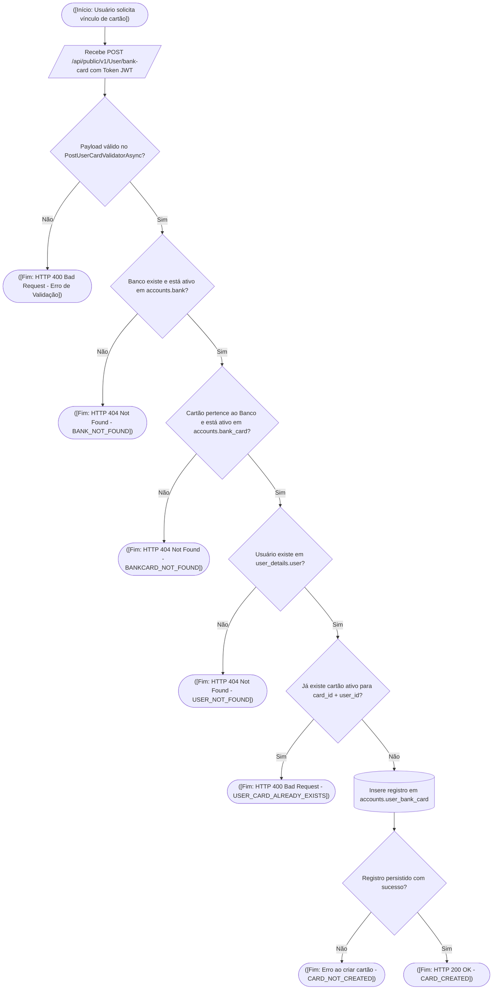
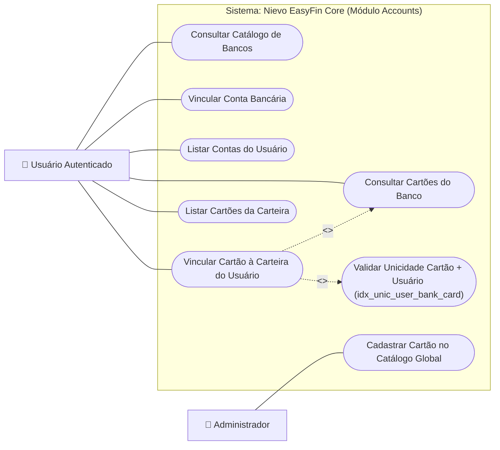

# Fluxo de Gestão de Contas Bancárias e Cartões

A gestão de contas e cartões no **Nievo EasyFin** é coordenada pelo Monólito `NievoEasyFin.Core` atuando sobre o esquema **`accounts`** do PostgreSQL, estruturada em controladores RESTful específicos (`UserController`, `BankController` e `CardController`).

---

## 🏦 1. Vínculo de Contas Bancárias (`accounts.user_bank`)

---

## 💳 2. Cadastro e Vínculo de Cartões (`accounts.user_bank_card`)

### 2.1 Fluxo de Decisão (Decision Flow - `POST /api/public/v1/User/bank-card`)

### 2.2 Casos de Uso (Use Case Diagram - Gestão de Contas e Cartões)

### 2.3 Diagrama de Classes (`CoreUserService` e `UserBankCardModel`)

```mermaid
classDiagram
    direction TB

    class UserController {
        <<controller>>
        -ICoreUserService _userService
        -JsonWebTokenService _jsonWebTokenService
        +PostUserBanks(authorization: string, request: PostUserBanksRequest) Task~IActionResult~
        +GetUserBanks(authorization: string, request: GetUserBanksRequest) Task~IActionResult~
        +GetUserCard(authorization: string, request: GetUserCardRequest) Task~IActionResult~
        +PostUserCard(authorization: string, request: PostUserCardRequest) Task~IActionResult~
    }

    class ICoreUserService {
        <<interface>>
        +PostUserBanks(request: PostUserBanksRequest) Task~IActionResult~
        +GetUserBanks(request: GetUserBanksRequest) Task~IActionResult~
        +GetUserCard(request: GetUserCardRequest) Task~IActionResult~
        +PostUserCard(request: PostUserCardRequest) Task~IActionResult~
        +PostUserGoal(request: PostUserGoalRequest) Task~IActionResult~
        +GetUserGoal(request: GetUserGoalRequest) Task~IActionResult~
        +PostUserCategory(request: PostUserCategoryRequest) Task~IActionResult~
        +GetUserCategory(request: GetUserCategoryRequest) Task~IActionResult~
    }

    class CoreUserService {
        <<service>>
        -UserModel _userModel
        -UserBankModel _userBankModel
        -UserBankCardModel _userBankCardModel
        -BankModel _bankModel
        -BankCardModel _bankCardModel
        +PostUserCard(request: PostUserCardRequest) Task~IActionResult~
        +GetUserCard(request: GetUserCardRequest) Task~IActionResult~
    }

    class UserBankCardModel {
        <<repository>>
        -CoreOrigin _CoreMainNodeDatabase
        -CoreReplica _CoreReplicaNodeDatabase
        +CreateUserBankCard(bankId: int, cardId: int, userId: int, cardUserName: string, expireAt: DateTime) Task~UserBankCardEntity~
        +GetUserBankCardByCardIdAndUserId(card_id: int, user_id: int) Task~UserBankCardEntity~
        +GetUserBankCard(page: int, pageSize: int, bankId: int?, userId: int, active: bool, flag: string?) Task~Tuple~
    }

    class UserBankCardEntity {
        <<entity>>
        +int Id
        +int BankId
        +string Name
        +int CardId
        +bool Active
        +int UserId
        +DateTime ExpiredAt
        +DateTime CreatedAt
        +DateTime UpdatedAt
    }

    class PostUserCardRequest {
        +int BankId
        +string CardUserName
        +int CardId
        +DateTime ExpireAt
    }

    class PostUserCardValidatorAsync {
        +ValidateAsync(request: PostUserCardRequest) Task~ValidationResult~
        -ValidateExpiredAt(x: DateTime) bool
    }

    UserController --> ICoreUserService : delegates
    CoreUserService ..|> ICoreUserService : implements
    CoreUserService --> UserBankCardModel : uses
    CoreUserService ..> PostUserCardRequest : receives
    CoreUserService ..> PostUserCardValidatorAsync : validates with
    UserBankCardEntity <|-- UserBankCardModel : inherits
```

### 📌 Tabelas e Índices do Esquema `accounts` Utilizados:
- `accounts.bank`: Instituições bancárias cadastradas (`id`, `name`, `bank_type`, `active`).
- `accounts.bank_type`: Classificação de bancos (`id`, `name`, `description`).
- `accounts.user_bank`: Vínculo entre usuário e banco (`id`, `user_id`, `bank_id`, `nick_name`, `active`).
- `accounts.bank_card`: Catálogo de cartões (`id`, `bank_id`, `name`, `card_type`, `flag_id`, `active`).
- `accounts.bank_card_type`: Tipos de cartão (`Crédito`, `Débito`, `Múltiplo`).
- `accounts.bank_card_flag`: Bandeiras (`Visa`, `Mastercard`, `Elo`, `Amex`).
- `accounts.user_bank_card`: Cartões do usuário (`id`, `bank_id`, `card_id`, `user_id`, `name`, `expired_at`, `active`), protegido pelo índice único `idx_unic_user_bank_card` sobre `(card_id, user_id)`.

---

## 🛡️ 3. Operações Administrativas (`/api/private/v1/Bank`)

- **`POST /api/private/v1/Bank`:** Insere registros de instituições financeiras na tabela `accounts.bank`.
- **`POST /api/private/v1/Bank/card`:** Insere novos produtos no catálogo de cartões `accounts.bank_card`.
