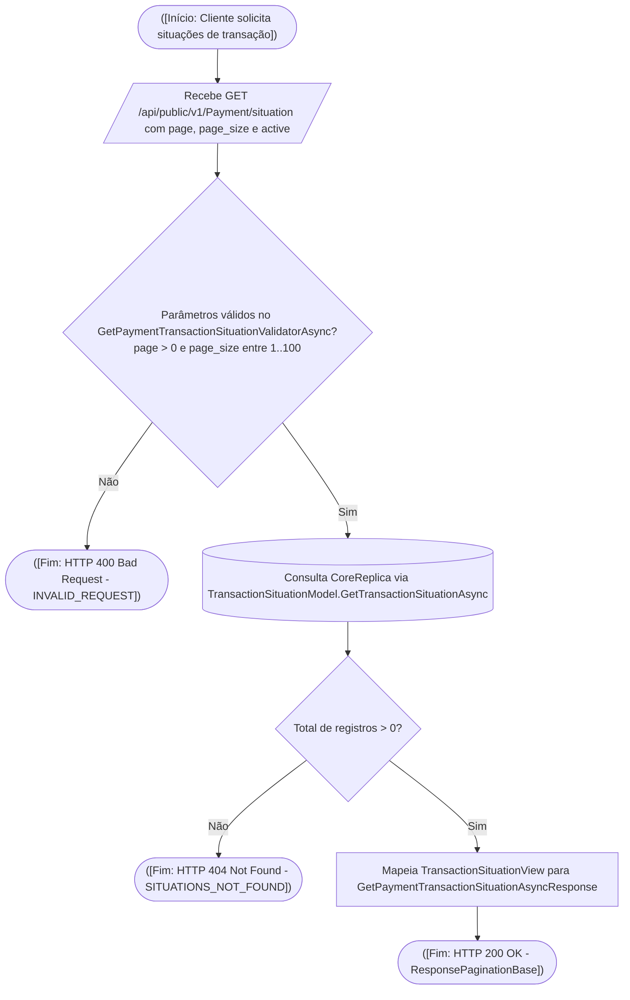
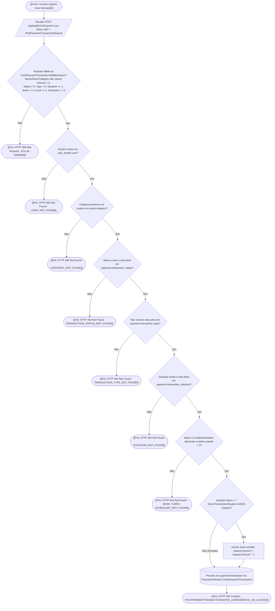
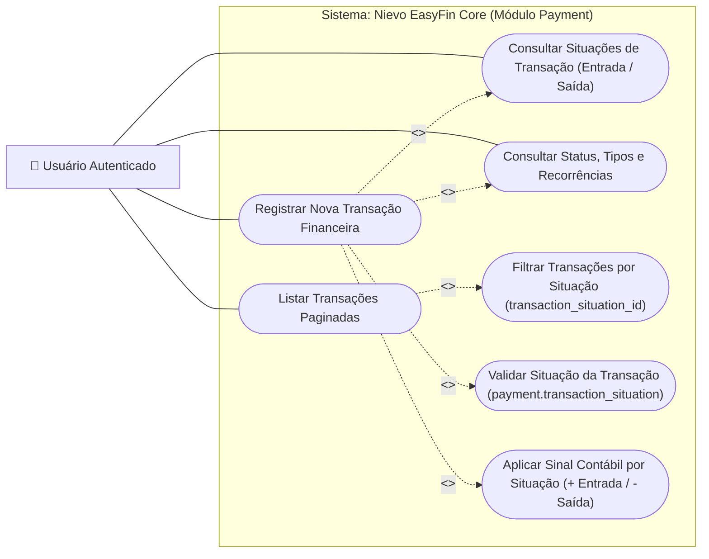

# Fluxo de Transações Financeiras e Situação de Caixa (`payment`)

O gerenciamento de lançamentos financeiros e fluxo de caixa no **Nievo EasyFin** é coordenado pelo Monólito `NievoEasyFin.Core` através do controlador RESTful `PaymentController` (`/api/public/v1/Payment`) e do serviço `PaymentService`, operando sobre o esquema **`payment`** do PostgreSQL.

---

## 💸 1. Situação da Transação (`payment.transaction_situation`)

Toda transação financeira registrada na plataforma é classificada de acordo com sua situação de fluxo de caixa na tabela de domínio `payment.transaction_situation` e mapeada no backend pelo enumerador `EnumTransactionSituation`:
- **`Entrada` (`EnumTransactionSituation.ENTRADA = 1`)**: Receitas, créditos, salários, reembolsos ou aportes recebidos pelo usuário (mantém `amount` positivo).
- **`Saida` (`EnumTransactionSituation.SAIDA = 2`)**: Despesas, débitos, pagamentos de faturas ou transferências enviadas pelo usuário (converte automaticamente `request.Amount = request.Amount * -1` no `PaymentService` antes da gravação).

### 1.1 Fluxo de Decisão — Consulta de Situações (`GET /api/public/v1/Payment/situation`)

---

## 🧾 2. Registro e Consulta de Transações (`payment.transaction`)

### 2.1 Fluxo de Decisão — Criação de Transação (`POST /api/public/v1/Payment`)

---

## 🎯 3. Casos de Uso (Use Case Diagram — Módulo Payment)

---

## 🏗️ 4. Diagrama de Classes (`PaymentController`, `PaymentService` e `Models`)

```mermaid
classDiagram
    direction TB

    class PaymentController {
        <<controller>>
        -IPaymentService _paymentService
        -JsonWebTokenService _jsonWebTokenService
        +PostPaymentTransaction(authorization: string, request: PostPaymentTransactionRequest) Task~IActionResult~
        +GetPaymentTransaction(authorization: string, request: GetPaymentTransactionRequest) Task~IActionResult~
        +GetPaymentTransactionStatus(authorization: string, request: GetPaymentTransactionStatusRequest) Task~IActionResult~
        +GetPaymentTransactionType(authorization: string, request: GetPaymentTransactionTypeRequest) Task~IActionResult~
        +GetPaymentTransactionScheduler(authorization: string, request: GetPaymentTransactionSchedulerRequest) Task~IActionResult~
        +GetPaymentTransactionSituation(authorization: string, request: GetPaymentTransactionSituationRequest) Task~IActionResult~
    }

    class IPaymentService {
        <<interface>>
        +PostPaymentTransaction(request: PostPaymentTransactionRequest) Task~IActionResult~
        +GetPaymentTransaction(request: GetPaymentTransactionRequest) Task~IActionResult~
        +GetPaymentTransactionStatus(request: GetPaymentTransactionStatusRequest) Task~IActionResult~
        +GetPaymentTransactionType(request: GetPaymentTransactionTypeRequest) Task~IActionResult~
        +GetPaymentTransactionScheduler(request: GetPaymentTransactionSchedulerRequest) Task~IActionResult~
        +GetPaymentTransactionSituation(request: GetPaymentTransactionSituationRequest) Task~IActionResult~
    }

    class PaymentService {
        <<service>>
        -UserModel _userModel
        -CategoryModel _categoryModel
        -UserBankModel _userBankModel
        -UserBankCardModel _userBankCardModel
        -TransactionStatusModel _transactionStatusModel
        -TransactionTypeModel _transactionTypeModel
        -SchedulerTypeModel _schedulerTypeModel
        -TransactionModel _transactionModel
        -TransactionSituationModel _transactionSituationModel
        +PostPaymentTransaction(request: PostPaymentTransactionRequest) Task~IActionResult~
        +GetPaymentTransaction(request: GetPaymentTransactionRequest) Task~IActionResult~
        +GetPaymentTransactionSituation(request: GetPaymentTransactionSituationRequest) Task~IActionResult~
    }

    class TransactionModel {
        <<repository>>
        -CoreOrigin _coreOrigin
        -CoreReplica _coreReplica
        +CreatePaymentTransaction(name: string, description: string, userId: int, transactionStatusId: int, transactionTypeId: int, transactionSituationId: int, categorieId: int, payDate: DateTime, amount: long, cardId: int?, bankId: int?, schedulerId: int?) Task~TransactionEntity?~
        +GetPaymentTransactionAsync(userId: int, page: int, pageSize: int, transactionStatusId: int?, transactionTypeId: int?, transactionSituationId: int?, categorieId: int?, payDate: DateTime?, cardId: int?, bankId: int?, schedulerId: int?, createdAt: DateTime?) Task~Tuple~
    }

    class TransactionEntity {
        <<entity>>
        +Guid Id
        +string Name
        +string? Description
        +int UserId
        +int TransactionStatusId
        +int TransactionTypeId
        +int TransactionSituationId
        +int? CategorieId
        +DateTime PayDate
        +long Amount
        +int? CardId
        +int? BankId
        +int? SchedulerId
        +DateTime CreatedAt
        +DateTime? UpdatedAt
    }

    class TransactionView {
        <<view>>
        +Guid Id
        +string Name
        +string? Description
        +string Status
        +string Type
        +string Situation
        +string? Categorie
        +DateTime PayDate
        +long Amount
        +string? Card
        +string? Bank
        +string? Scheduler
        +DateTime CreatedAt
        +int Records
    }

    class TransactionSituationModel {
        <<repository>>
        -CoreReplica _coreReplica
        +GetTransactionSituationById(id: int, active: bool) Task~TransactionSituationEntity?~
        +GetTransactionSituationAsync(page: int, pageSize: int, active: bool) Task~Tuple~
    }

    class TransactionSituationEntity {
        <<entity>>
        +int Id
        +string Name
        +string? Description
        +bool Active
        +DateTime CreatedAt
        +DateTime? UpdatedAt
    }

    class TransactionSituationView {
        <<view>>
        +int Id
        +string Name
        +string? Description
        +bool Active
        +int Records
    }

    class PostPaymentTransactionRequest {
        +string Name
        +string Description
        +int TransactionStatus
        +int TransactionType
        +int TransactionSituation
        +int Categorie
        +DateTime PayDate
        +long Amount
        +int? Card
        +int? Bank
        +int? Scheduler
    }

    class PostPaymentTransactionValidatorAsync {
        +ValidateAsync(request: PostPaymentTransactionRequest) Task~ValidationResult~
    }

    class GetPaymentTransactionSituationRequest {
        +bool Active
        +int Page
        +int PageSize
    }

    class GetPaymentTransactionSituationAsyncResponse {
        +int Id
        +string Name
        +string? Description
        +bool Active
    }

    class GetPaymentTransactionSituationValidatorAsync {
        +ValidateAsync(request: GetPaymentTransactionSituationRequest) Task~ValidationResult~
    }

    class EnumTransactionSituation {
        <<enumeration>>
        +ENTRADA = 1
        +SAIDA = 2
    }

    PaymentController --> IPaymentService : delegates
    PaymentService ..|> IPaymentService : implements
    PaymentService --> TransactionModel : uses
    PaymentService --> TransactionSituationModel : uses
    PaymentService ..> EnumTransactionSituation : evaluates
    TransactionEntity <|-- TransactionModel : inherits
    TransactionSituationEntity <|-- TransactionSituationModel : inherits
    TransactionModel ..> TransactionView : queries
    TransactionSituationModel ..> TransactionSituationView : queries
    PaymentService ..> PostPaymentTransactionRequest : receives
    PaymentService ..> PostPaymentTransactionValidatorAsync : validates with
    PaymentService ..> GetPaymentTransactionSituationRequest : receives
    PaymentService ..> GetPaymentTransactionSituationValidatorAsync : validates with
    PaymentService ..> GetPaymentTransactionSituationAsyncResponse : returns
```

