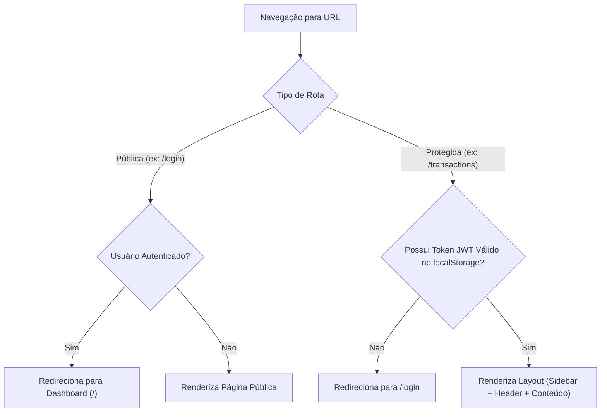
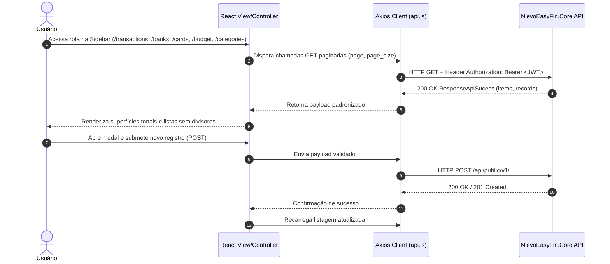

# Arquitetura e Componentes do Frontend

O cliente web do **Nievo EasyFin** é uma Single Page Application (SPA) moderna, acessível e responsiva construída em **React 19** com o bundler de alta performance **Vite 7** e estilização visual com **Material UI (MUI)**, seguindo o Design System **"The Intentional Calm / The Silent Navigator"**.

---

## 🚀 1. Tecnologias e Decisões de Arquitetura

- **React 19 + Vite 7:** Escolhido pela inicialização instantânea do servidor de desenvolvimento (HMR), compilação ultrarrápida e footprint reduzido no bundle final de produção.
- **Material UI (MUI) & Design System "The Silent Navigator":** Utilizado como biblioteca padronizada de componentes com abordagem *tonal-first* (sem divisores de `1px`, priorizando camadas de superfície `surface.main`, `surface.high`, `surface.highest` e tipografia editorial `Manrope` + `Inter`).
- **React Router DOM (v7):** Gerenciamento de rotas do lado do cliente com suporte a rotas públicas, rotas protegidas e redirecionamentos automáticos.

---

## 📁 2. Padrão de Estrutura de Arquivos Modular

Cada página e componente modular no diretório `frontend/web/src/` segue rigorosamente a separação de responsabilidades em 4 arquivos padronizados:

```
src/pages/Transactions/
├── index.jsx      # Controller: gerencia estado, efeitos e regras de negócio
├── View.jsx       # Template: apresentação pura JSX e componentes MUI
├── styles.js      # Estilização customizada (MUI styled consumindo tokens do tema)
└── api.js         # Chamadas HTTP REST para os endpoints do backend via Axios
```

---

## 🛡️ 3. Gerenciamento de Rotas e Proteção de Sessão (`App.jsx`)

As rotas são classificadas entre **Rotas Públicas** e **Rotas Protegidas**:



### 🗺️ Tabela de Rotas da Aplicação:

| Rota | Componente | Tipo | Proteção | Endpoints Integrados | Descrição |
| :--- | :--- | :--- | :--- | :--- | :--- |
| `/login` | `Login` | Pública | `PublicRoute` | `POST /api/public/v1/Authenticator/singin`<br>`POST /api/public/v1/Authenticator/singin-sso` | Autenticação por e-mail/senha e login SSO Google. |
| `/register` | `Register` | Pública | `PublicRoute` | `POST /api/public/v1/Users/singup`<br>`POST /api/public/v1/Users/singup-sso` | Criação de conta com validação de termos. |
| `/forgot-password`| `ForgotPassword`| Pública | `PublicRoute` | `POST /api/public/v1/Users/password-reset`<br>`PATCH /api/public/v1/Users/password-reset` | Solicitação e confirmação de PIN de redefinição de senha. |
| `/confirm-email` | `ConfirmEmail` | Pública | `PublicRoute` | `POST /api/public/v1/Authenticator/validate:email` | Validação de PIN de ativação de conta. |
| `/terms` | `Terms` | Pública | Livre | `GET /api/public/v1/Authenticator/accept-terms:singup` | Exibição pública dos Termos de Uso vigentes no sistema. |
| `/` | `Dashboard` | Protegida| `ProtectedRoute` | `GET /dashboard` (Mock/ Futuro) | Visão geral de saldo, receitas e despesas recentes. |
| `/transactions` | `Transactions` | Protegida| `ProtectedRoute` | `GET / POST /api/public/v1/Payment`<br>`GET /api/public/v1/Payment/status`<br>`GET /api/public/v1/Payment/type`<br>`GET /api/public/v1/Payment/scheduler` | Listagem paginada com filtros e lançamento de transações financeiras. |
| `/banks` | `Banks` | Protegida| `ProtectedRoute` | `GET / POST /api/public/v1/User/banks`<br>`GET /api/public/v1/Bank` | Gestão de contas bancárias vinculadas ao usuário e catálogo de bancos. |
| `/cards` | `Cards` | Protegida| `ProtectedRoute` | `GET / POST /api/public/v1/User/bank-card`<br>`GET /api/public/v1/Bank/card`<br>`GET /api/public/v1/Card/type`<br>`GET /api/public/v1/Card/flag` | Carteira de cartões do usuário, filtros por bandeira/banco e catálogo de cartões. |
| `/budget` | `Budget` | Protegida| `ProtectedRoute` | `GET / POST /api/public/v1/User/goal` | Planejamento e criação de metas financeiras (valor fixo ou percentual). |
| `/categories` | `Categories` | Protegida| `ProtectedRoute` | `GET / POST /api/public/v1/User/category`<br>`GET /api/public/v1/User/goal` | Hierarquia de categorias com vínculo exclusivo a Metas ou Categoria Pai. |
| `/settings` | `Settings` | Protegida| `ProtectedRoute` | Preferências locais & segurança | Configurações da conta do usuário, tema visual e preferências. |

---

## 🔄 4. Fluxo de Integração Frontend ↔ Core API



---

## 🎨 5. Tema e Suporte Completo a Dados Simulados (`mockData.js`)

- **Contexto de Tema (`ThemeContext.jsx`):** Permite a alternância dinâmica entre modo claro (Light Mode) e modo escuro (Dark Mode) persistida em `localStorage`.
- **Mapeamento de Textos (`locales/texts.json`):** Centralização das strings e títulos de todas as seções da Sidebar e páginas para suporte a internacionalização via hook `useText()`.
- **Modo Demonstrativo 100% Funcional (`VITE_USE_MOCK=true`):** O interceptador em `src/services/mockData.js` simula em memória todos os endpoints de Autenticação e do Core (`Payment`, `User/banks`, `User/bank-card`, `User/goal`, `User/category`, `Bank`, `Card`), permitindo criar contas bancárias, cartões, metas, categorias e transações em tempo real sem depender do backend ativo, com resumo exposto no `MockGuidePopup`.
